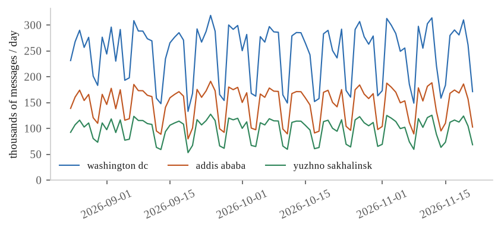
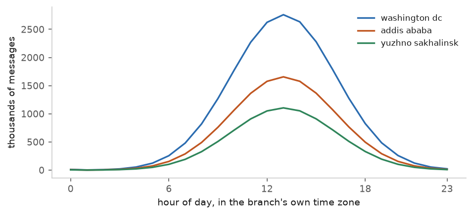
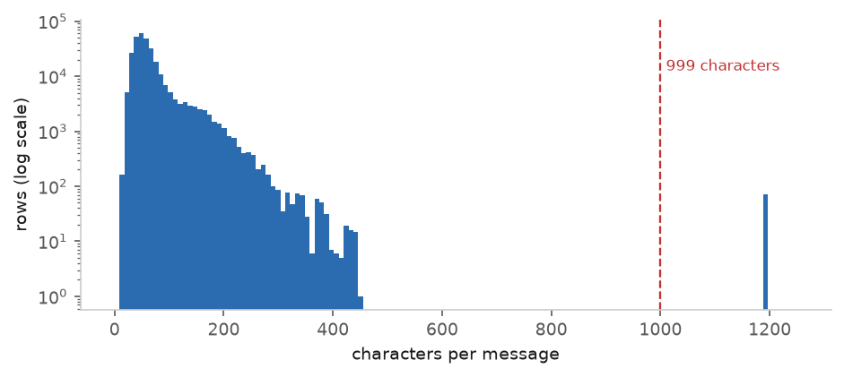
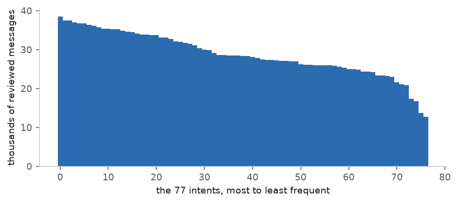
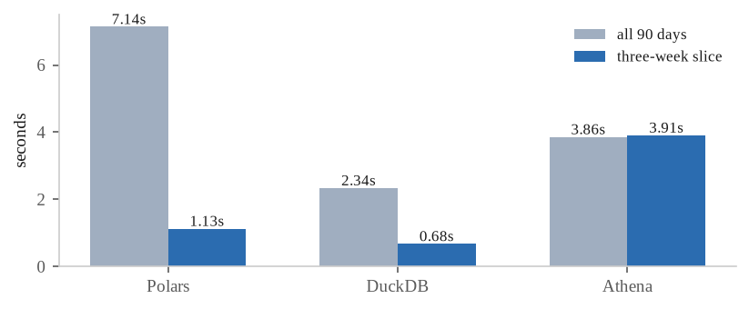

```{=typst}
#set page(
  footer: none,
  header: context {
    set text(size: 10pt)
    grid(columns: (1fr, auto),
      text(style: "italic")[DSAN 6000 EDA Progress Report],
      [#counter(page).display()])
  })
#set heading(numbering: (..n) => {
  let p = n.pos()
  if p.len() == 1 { numbering("1.", ..p) } else { numbering("1.1", ..p) }
})
#show heading.where(level: 1): set text(size: 13pt)
#show heading.where(level: 2): set text(size: 12pt)
#set par(justify: false, leading: 0.72em)

#align(center)[
  #text(size: 16pt, weight: "bold")[
    Catching Fraud in the Chat Box: Exploratory Analysis of a
    Simulated Banking77 Production Log
  ]
  #v(0.9em)
  #text(size: 12pt)[Yixuan He, Lanbin Fan, Zizheng Wang, and Ken Qin]
  #v(0.5em)
  #text(size: 12pt)[DSAN 6000: Big Data and Cloud Computing, Georgetown University]
  #linebreak()
  #text(size: 12pt)[EDA Progress Report]
  #linebreak()
  #text(size: 12pt)[November 22, 2026]
]
#v(1.0em)
```

**Scope.** Progress report for the week of November 22: the simulated
production log is built and in S3, and this is what it looks like.

# Overview

Banking77 [@casanueva2020] ships 13,083 customer-chat messages in about 1 MB,
and every one of them carries an intent label. A bank's live chatbot stream
looks nothing like that. It is large, it arrives continuously, and almost none
of it has been reviewed — the `label` field is `NA` until a human gets to it.

Our proposal committed to replaying Banking77 into a log that behaves the way
the real stream would. That log now exists. This report checks that it has the
properties we claimed, and reports what we found when we queried it three
different ways.

# The simulated log

## Structure

Each row is one message sent to the chatbot. The three OLTP fields named in the
course vignette are kept as-is, with two additions: a stable identifier, so a
review arriving later can be matched back to the original row, and a column
recording which rows we planted.

| Column | Type | Notes |
|---|---|---|
| `msg_id` | string | Stable across re-generation |
| `label` | int32 | Intent 0–76; **null** when not yet reviewed |
| `text` | string | Message body |
| `received` | timestamp | UTC |
| `injected_type` | string | Evaluation ground truth; null for ordinary rows |

: Schema of the simulated log. `date` and `branch` are Hive partition keys and
live in the path rather than the file. {#tbl-schema}

## Scale and access

| | |
|---|---|
| Rows | 44,464,114 |
| Partitions | 270 (90 dates × 3 branches) |
| On disk | 1.99 GB Parquet |
| Window | 2026-08-24 to 2026-11-21 |
| Reviewed | 2,221,185 (5.0%) |
| Location | `s3://dsan6000-banking77-team/raw/` |

: Scale of the log as built. {#tbl-scale}

Every figure in this report was produced by Polars reading that S3 copy
directly. Nothing was downloaded onto the EC2 instance.

Because each of us has a separate AWS account, we did not share a bucket.
The generator is deterministic instead, so the same two commands produce a
byte-identical copy in any account:

```bash
python scripts/generate_log.py --rows 50000000 --days 90 --start 2026-08-24 --out log
aws s3 sync log/ s3://<your-bucket>/raw/
```

# What the data looks like

## Traffic

{#fig-daily}

Volume holds steady across the window with a clear weekend dip. Washington DC
carries half the traffic, Addis Ababa a third, Yuzhno-Sakhalinsk a fifth.

{#fig-clock}

@fig-clock is the more useful view. All three branches peak near 13:00 local
time, but they sit eleven and sixteen hours apart, so in UTC those peaks fall
at 18:00, 10:00 and 02:00. One branch is at its busiest while another is
asleep.

This has a direct consequence for the ingest design in our proposal. We had
planned to take micro-batch snapshots "at the low points of the branches'
combined traffic." @fig-clock shows there is no such hour: the combined curve
never goes quiet. Snapshots will have to be scheduled per branch, against each
branch's own local trough.

## Review coverage

{#fig-coverage}

2,221,185 of 44,464,114 rows carry an intent label, and the 5% share is the
same in every branch. The remaining 95% is what the fraud-ranking model has to
work on. This is why the problem is a ranking problem before it is a
classification problem: for most rows there is nothing to compare a prediction
against.

## Message length

{#fig-length}

Half of all messages are under 54 characters and the ordinary tail dies out
near 450. The 8,758 rows past 999 characters are the planted token-flooding
attack, and there is nothing in between.

That gap is a weakness of the simulation, not a result. A length threshold
alone separates the flooding perfectly here, which real flooding would not do.
We will keep the length feature but will not tune against this margin.

## Intent imbalance

{#fig-intents}

The most frequent intent, `card_payment_fee_charged`, has 38,560 reviewed
messages; the least frequent, `contactless_not_working`, has 12,704. The 3.04
ratio is mild next to most production label distributions, but it is enough
that overall accuracy will read higher than per-class recall. We will report
macro-F1 alongside accuracy.

## Vocabulary drift

{#fig-drift}

This is the Zimbabwe-gold case from the course vignette, planted on
`supported_cards_and_currencies` (intent 54). Until late October no reviewed
message on that intent uses the new wording; five weeks later 69% of them do.

The useful observation is that the degradation is invisible in aggregate. One
intent out of 77 shifting would barely move overall accuracy, so a monitor
watching a single global metric would not see it. Per-intent confidence
tracking would.

# Querying the lake

We ran one query — messages and reviewed messages per branch — three ways
against the same S3 Parquet: once across all 90 days, once across a three-week
slice. The pair separates how fast an engine is from how much work partition
pruning saves it.

{#fig-engines}

| Engine | All 90 days | Three-week slice | Speed-up |
|---|---|---|---|
| Polars | 7.14 s | 1.13 s | 6.3× |
| DuckDB | 2.34 s | 0.68 s | 3.4× |
| Athena | 3.86 s | 3.91 s | — |

: Wall-clock time, same query, same data. {#tbl-engines}

Pruning helps both local engines substantially and does nothing for Athena,
because what Athena spends here is start-up rather than scanning. Its bytes
tell the real story.

| Athena query | Data scanned |
|---|---|
| All 90 days | 5.9 MB |
| Three-week slice | 1.4 MB |
| Files on disk | 1,990 MB |

: Bytes Athena actually read. {#tbl-scanned}

Counting all 44.5M rows cost 5.9 MB of reads. Parquet hands the engine only
the two columns the query names and skips the other five, and the partition
keys are read from the path rather than from any file. Narrowing to three
weeks cut that by a further 4.2×.

The roughly 3.9 s Athena pays regardless is fixed serverless start-up. At this
size that overhead dominates and the local engines win; at a hundred times
this size, Athena's scanning model would win instead.

{#fig-partitions}

The 270 partitions run from 53,198 to 318,754 rows, a 6.0× spread. The three
clusters in @fig-partitions are the three branches; within each, the lower lobe
is weekends.

# Caveats

**Only 492,380 distinct message texts across 44,464,114 rows — each repeats
about 90 times.** The perturbation applied during replay produces far fewer
unique strings than the row count suggests. Splitting the rows at random would
put near-identical messages in both train and test and make the model look
considerably better than it is. We will split by message cohort, or
deduplicate before evaluating, and will state which.

**The fraud labels are ours, not Banking77's.** Precision and recall on the
planted rows measure whether the pipeline catches patterns we designed
ourselves. They are not evidence about real fraud. The final report will say so
in the results section rather than in a footnote.

**The partition sizes are uneven by construction.** Weekday-weekend rhythm and
branch size drive the 6.0× spread, so the imbalance is structural and will
persist in any re-generation of the log.

# References

::: {#refs}
:::
