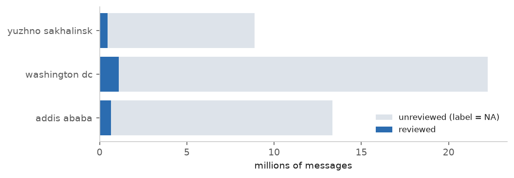
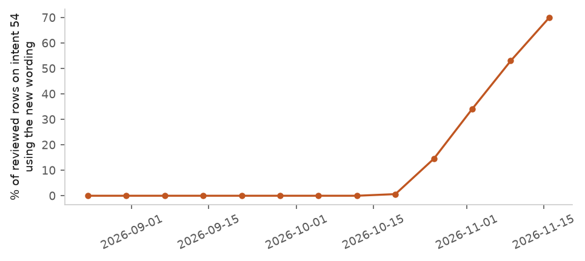
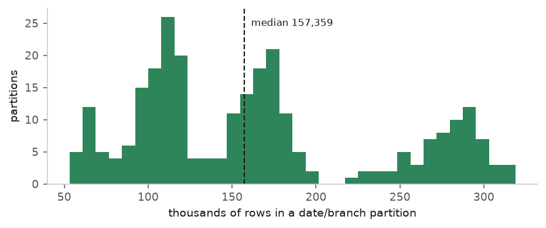

## What we built, and why

Banking77 ships 13,083 customer messages in about 1 MB, and every one of them
carries an intent label. A bank's live chatbot stream looks nothing like that.
It is large, it arrives continuously, and almost none of it has been reviewed —
the `label` field is `NA` until someone gets to it.

So the first stage of the project was to build a log that behaves the way the
real thing would. We replay the 13,083 messages into 90 days of traffic across
three branches, each running on its own local business hours, with review
coverage set to 5% and three adversarial patterns planted in. The result lives
in S3 as Hive-partitioned Parquet, and it is the input to everything that
follows.

| | |
|---|---|
| Rows | 44,464,114 |
| Columns | 5 data + 2 partition keys |
| Partitions | 270 (90 dates × 3 branches) |
| On disk | 1.99 GB Parquet |
| Window | 2026-08-24 to 2026-11-21 |
| Location | `s3://dsan6000-banking77-team/raw/` |

Every number in this report came from Polars reading that S3 copy directly.
Nothing was downloaded to the instance.

The generator is deterministic, so each of us can reproduce a byte-identical
copy in our own AWS account rather than sharing a bucket across accounts:

```bash
python scripts/generate_log.py --rows 50000000 --days 90 --start 2026-08-24 --out log
aws s3 sync log/ s3://<your-bucket>/raw/
```

## The shape of the traffic

{#fig-daily}

Volume holds steady over the window with a clear weekend dip. Washington DC
carries half the traffic, Addis Ababa a third, Yuzhno-Sakhalinsk a fifth.

{#fig-clock}

@fig-clock is the more useful view. All three branches peak near 13:00 local
time, but their time zones are eleven and sixteen hours apart, so in UTC those
peaks land at 18:00, 10:00 and 02:00. One branch is at its busiest while
another is asleep. That matters for the ingest design: there is no hour when
all three are quiet, so a nightly batch window does not exist, and the
micro-batch snapshots have to be scheduled per branch.

## How little of it is labelled

{#fig-coverage}

2.22M of 44.46M rows carry an intent label — 5.0%. The share is the same in
every branch, so no branch is better covered than another. The other 95% is
what the fraud-ranking model actually has to work on, and it is the reason the
project is a ranking problem before it is a classification problem.

## Message length, and the first planted pattern

{#fig-length}

Half of all messages are under 54 characters, and the ordinary tail dies out
near 450. The 8,758 rows past 999 characters are the planted token-flooding
attack, and there is nothing at all in between. A length threshold alone would
catch every one of them in this log — which is a warning about the simulation
rather than a finding about fraud. Real flooding would not separate this
cleanly, and the modelling stage should not be tuned against a gap this
convenient.

## Class imbalance across the 77 intents

{#fig-intents}

The most frequent intent, `card_payment_fee_charged`, has 38,560 reviewed
messages; the least frequent, `contactless_not_working`, has 12,704. A ratio of
3.04 is mild compared with most real label distributions, but it is enough that
overall accuracy will look better than per-class recall, so macro-F1 is the
metric we will report.

## Vocabulary drift

{#fig-drift}

This is the Zimbabwe-gold scenario from the course vignette, planted
deliberately. Until late October, no reviewed message on
`supported_cards_and_currencies` uses the new wording. Five weeks later, 69% of
them do.

The practical point is that the degradation is invisible in aggregate. Overall
accuracy would barely move, because this is one intent out of 77. A monitor
that watches only a global metric would miss it; per-intent confidence tracking
would not.

## Querying the lake

We ran one query — messages and reviewed messages per branch — three ways over
the same S3 Parquet: once across all 90 days, once across a three-week slice.
The pair separates how fast an engine is from how much work partition pruning
saves it.

{#fig-engines}

| Engine | All 90 days | Three-week slice | Speed-up |
|---|---|---|---|
| Polars | 7.14 s | 1.13 s | 6.3× |
| DuckDB | 2.34 s | 0.68 s | 3.4× |
| Athena | 3.86 s | 3.91 s | — |

Pruning helps the two local engines a great deal and does nothing for Athena,
because what Athena spends here is start-up, not scanning. Its bytes tell the
real story:

| Athena query | Data scanned |
|---|---|
| All 90 days | 5.9 MB |
| Three-week slice | 1.4 MB |
| Files on disk | 1,990 MB |

Counting all 44.5M rows cost 5.9 MB of reads. Parquet hands the engine only the
two columns the query names and skips the other five, and the partition keys
are read from the path rather than the file. Narrowing to three weeks cut that
by a further 4.2×.

The ~3.9 s Athena pays regardless is fixed serverless start-up. At this size
that overhead dominates and the local engines win; at a hundred times this
size, Athena's scanning model would win instead. This is the trade-off we will
revisit with Spark.

{#fig-partitions}

The 270 partitions run from 53,198 to 318,754 rows, a 6.0× spread. The three
clusters in @fig-partitions are the three branches; within each cluster, the
lower lobe is weekends.

## Caveats the modelling stage has to live with

**Only 492,380 distinct message texts across 44,464,114 rows — each repeats
about 90 times.** The perturbation applied during replay produces fewer unique
strings than the row count suggests. Split the rows at random and
near-identical messages land in both train and test, which would make the model
look considerably better than it is. We will split by message cohort, or
deduplicate before evaluating, and report which.

**The fraud labels are ours, not Banking77's.** Precision and recall on the
planted rows measure whether the pipeline catches patterns we designed
ourselves. They are not evidence about real fraud. The final report will say so
in the results section rather than in a footnote.

**The partition sizes are uneven by construction.** Weekday-weekend rhythm and
branch size drive the 6.0× spread, so the imbalance is structural rather than
accidental, and it will persist in any re-generation of the log.
